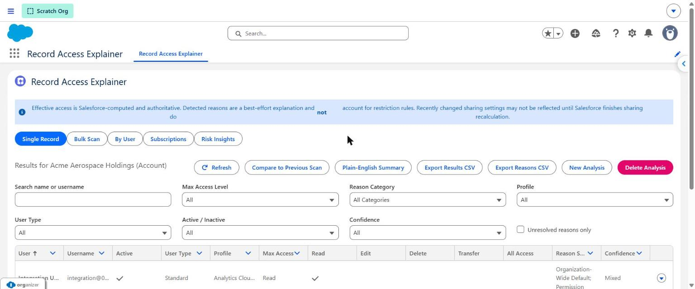
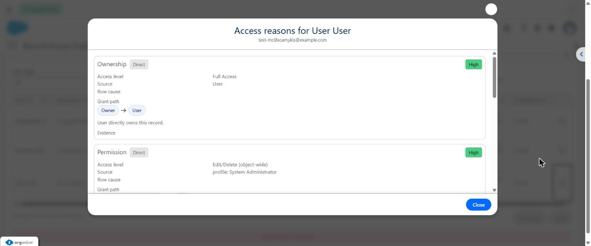
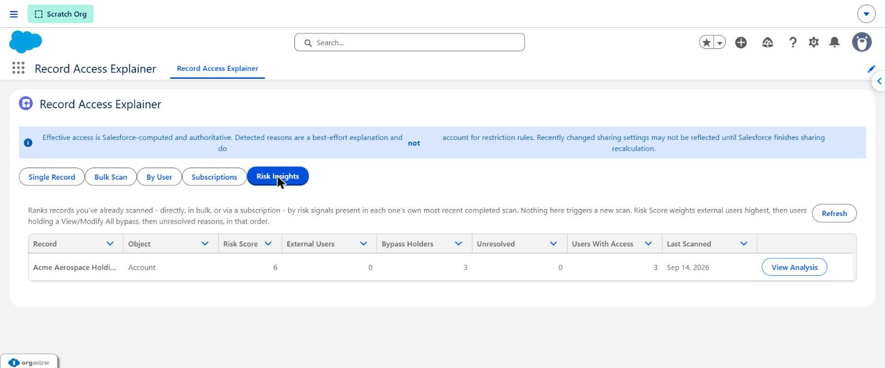

# Record Access Explainer

[](https://github.com/new1earn5/record-access-explainer/actions/workflows/ci.yml)
[](LICENSE)

A Salesforce administrator/auditor application that answers one question in depth: **"Which
users have effective access to this record, and why?"**

Enter any record ID and Record Access Explainer runs a background scan against the org's user
population, reports Salesforce's own computed effective access for every user (via
`UserRecordAccess`), and then explains — separately, with a confidence rating on each claim — the
sharing mechanisms it can prove are responsible: ownership, role hierarchy, direct and group
shares, sharing rules, permission bypasses, teams, territories, and controlled-by-parent chains.

This project was built, deployed to a live scratch org, and test-verified (162/162 Apex tests,
58/58 LWC Jest tests passing) during generation. Every SOQL/Schema behavior described below —
including several platform restrictions that are easy to get wrong — was confirmed against a real
org, not assumed.

Beyond the core single-record scan, it also includes bulk/list scanning, a reverse "by user" mode,
analysis history diffing, field-level security tracing, a live sharing-recalculation warning,
best-effort Restriction Rule detection, a Risk Insights view ranking already-scanned records, a
deterministic plain-English scan summary, and optional scheduled recurring scans with email and/or
Chatter change alerts — see §8.

|                                                                                                                 |                                                                                           |
| --------------------------------------------------------------------------------------------------------------- | ----------------------------------------------------------------------------------------- |
|                                                               |                                     |
| Per-user access results for a scanned record, with export, plain-English summary, and previous-scan comparison. | Drill-down into _why_ a user has access — grant path, source, and confidence, per reason. |


_Risk Insights ranks every record you've already scanned by external users, bypass holders, and unresolved reasons — no new scan required._

---

## Quick Start

Requires the [Salesforce CLI](https://developer.salesforce.com/tools/salesforcecli) (`sf`).

```bash
sf org login web --alias my-org
sf project deploy start --source-dir force-app --target-org my-org
sf org assign permset --name RAA_Record_Access_Auditor --target-org my-org
```

Then open the **Record Access Explainer** tab or app in Lightning Experience, enter any record ID,
and click **Analyze**.

Full deployment options: [§9](#9-deployment-instructions). Permission set / Lightning page setup:
[§11](#11-permission-set-assignment-instructions)–[§12](#12-lightning-application-setup-instructions).
Test/lint/format commands: [§10](#10-test-lint-and-format-execution-instructions).

## Table of Contents

- [Quick Start](#quick-start)
- [1. Architecture Overview](#1-architecture-overview)
- [2. Data Model](#2-data-model)
- [3. Security Model](#3-security-model)
- [4. Supported Access Reasons](#4-supported-access-reasons)
- [5. Known Limitations](#5-known-limitations)
- [6. Required Operator Permissions](#6-required-operator-permissions)
- [7. Effective Access vs. Reason Attribution](#7-effective-access-vs-reason-attribution)
- [8. Additional Capabilities](#8-additional-capabilities)
- [9. Deployment Instructions](#9-deployment-instructions)
- [10. Test, Lint, and Format Execution Instructions](#10-test-lint-and-format-execution-instructions)
- [11. Permission Set Assignment Instructions](#11-permission-set-assignment-instructions)
- [12. Lightning Application Setup Instructions](#12-lightning-application-setup-instructions)

---

## 1. Architecture Overview

```
                        ┌─────────────────────────────┐
                        │  raaRecordAccessExplainer    │  LWC (tab / app page / utility bar)
                        │  raaReasonDetail (child)      │
                        └───────────────┬───────────────┘
                                        │ @AuraEnabled
                        ┌───────────────▼───────────────┐
                        │ RAA_RecordAccessExplainerController │  with sharing
                        │  - checks custom permission     │
                        │  - re-checks record visibility  │
                        └───────────────┬───────────────┘
                                        │
                        ┌───────────────▼───────────────┐
                        │ RAA_AnalysisOrchestratorService │  without sharing (elevated boundary)
                        │  - validates & resolves record  │
                        │  - starts/cancels/deletes scans │
                        └───────┬───────────────┬─────────┘
                                │               │
                  ┌─────────────▼───┐   ┌───────▼──────────┐
                  │ RAA_AccessScanBatch │   │ RAA_AnalysisRepository │
                  │  Database.Batchable  │   │  all DML/SOQL on RAA_* │
                  │  Database.Stateful   │   └───────────────────────┘
                  └─────────┬───────────┘
                            │ per chunk
                  ┌─────────▼───────────┐
                  │ RAA_ReasonAggregator  │  confirms effective access, then fans out
                  └─────────┬───────────┘
        ┌──────────┬────────┼────────┬───────────┬────────────┬──────────────┐
        ▼          ▼        ▼        ▼           ▼            ▼              ▼
   Ownership   RoleHier  ShareRow  Permission   Team      Territory   ParentControlled → OWD
```

Key design decisions, all verified empirically against a live org rather than assumed:

- **`UserRecordAccess` cannot be bulk-queried by a list of users for one record.** Its supported
  filter shapes are `UserId = [single] AND RecordId = [single or IN list]` — `UserId IN [list]` is
  rejected at compile time. Because a scan is always "one record, many users" (the inverse of what
  the object supports), `RAA_UserRecordAccessProvider` issues one query per user per batch chunk.
  This is the **one deliberate, documented exception** to "no SOQL in a loop"; every other data
  source (share rows, groups, permission sets, teams, territories) is bulk-queried once per chunk.
- **There is no supported API for the org-wide default value itself.** `Schema.DescribeSObjectResult`
  has no `getSharingModel()` method, `Schema.SharingModel` is not a real Apex type, and
  `EntityDefinition` (queried through plain SOQL) has no `SharingModel` column. `RAA_OrgWideDefaultAnalyzer`
  reports this honestly (Low confidence, "could not be conclusively retrieved") instead of guessing.
- **"Controlled by Parent" _is_ reliably detectable**, just not through a sharing-model enum:
  `DescribeFieldResult.isCascadeDelete()` is true only for master-detail fields, and Salesforce
  enforces Controlled-By-Parent sharing unconditionally for any object that has one.
  `RAA_ContextBuilder` uses this to locate the controlling parent field for `RAA_ParentControlledAnalyzer`.
- **Account Teams, Case Teams, and Enterprise Territory Management are optional, unlicensed-by-default
  features.** `AccountTeamMember`, `OpportunityTeamMember`, `CaseTeamMember`, `CaseTeamRole`,
  `Territory2`, `UserTerritory2Association`, and `ObjectTerritory2Association` are referenced only
  through fully dynamic SOQL (`Database.query` against a `List<SObject>`), never as compile-time
  types — a static reference would break deployment entirely in any org where the feature was never
  turned on. `RAA_TeamAnalyzer` and `RAA_TerritoryAnalyzer` check `Schema.getGlobalDescribe()` first
  and silently contribute nothing when the feature is absent.
- **Batch Apex runs in system mode for object/field permissions.** Only record-level sharing is
  governed by a class's `with`/`without sharing` keyword; Batch, Queueable, Scheduled, and Future
  Apex all ignore CRUD/FLS regardless. `RAA_AccessScanBatch` is declared `without sharing`
  deliberately so the scan itself sees the full picture, independent of the requesting operator's
  own object permissions — the operator only needs the custom permission to trigger it.
- **Scan status reaches the UI by push, not just polling.** `RAA_AccessScanBatch.finish()`
  publishes a platform event (`RAA_Scan_Status_Event__e`) whenever an analysis reaches a terminal
  status; `raaRecordAccessExplainer` subscribes via `lightning/empApi` and refreshes immediately
  on a matching event instead of waiting for its next poll tick. Polling (every 10s) still runs
  as a fallback for a missed or not-yet-established subscription, so nothing depends on the push
  channel being reliable. Finding and fixing this also surfaced a real, previously-untested bug:
  both `start()` and `finish()` guarded only against a `Cancelled` status specifically, so an
  analysis that `start()` itself had already marked `Failed` (for example, exceeding
  `RAA_Max_Users_Per_Scan__c`) could be silently overwritten back to `Running`/`Completed` by the
  rest of the batch running anyway. Both methods now guard on `RAA_Is_Complete__c` instead of one
  named status, which covers every terminal state uniformly.

### Apex components

| Layer            | Class                                                                                                                                                                                                                                       | Responsibility                                                                                 |
| ---------------- | ------------------------------------------------------------------------------------------------------------------------------------------------------------------------------------------------------------------------------------------- | ---------------------------------------------------------------------------------------------- |
| Controller       | `RAA_RecordAccessExplainerController`                                                                                                                                                                                                       | Sole `@AuraEnabled` surface. `with sharing`. Permission + visibility gate.                     |
| Orchestration    | `RAA_AnalysisOrchestratorService`                                                                                                                                                                                                           | Elevated (`without sharing`) service boundary; never Aura-enabled.                             |
| Async            | `RAA_AccessScanBatch`                                                                                                                                                                                                                       | `Database.Batchable<Id>, Database.Stateful`. One chunk = one bulk pass.                        |
| Scheduling       | `RAA_CleanupScheduler`                                                                                                                                                                                                                      | Optional `Schedulable` retention cleanup.                                                      |
| Effective access | `RAA_IEffectiveAccessProvider` / `RAA_UserRecordAccessProvider`                                                                                                                                                                             | `UserRecordAccess` wrapper, swappable in tests.                                                |
| Context          | `RAA_ContextBuilder` / `RAA_AnalysisContext`                                                                                                                                                                                                | Bulk-loads record, owner, share object, share rows once.                                       |
| Metadata         | `RAA_RecordMetadataResolver`, `RAA_ShareObjectResolver`                                                                                                                                                                                     | Dynamic object/share-table discovery via `Schema`.                                             |
| Reason engine    | `RAA_IReasonAnalyzer` + 8 implementations                                                                                                                                                                                                   | Strategy pattern; see §4.                                                                      |
| Aggregation      | `RAA_ReasonAggregator`                                                                                                                                                                                                                      | Confirms effective access, fans out to analyzers, dedupes, sorts.                              |
| Groups           | `RAA_GroupGraphResolver`                                                                                                                                                                                                                    | Bulk BFS over `Group`/`GroupMember`, cycle-safe.                                               |
| Persistence      | `RAA_AnalysisRepository`                                                                                                                                                                                                                    | All DML/SOQL against the RAA data model; idempotent upserts.                                   |
| Population       | `RAA_UserPopulationBuilder`                                                                                                                                                                                                                 | Dynamic SOQL for the scan's candidate users.                                                   |
| Export           | `RAA_CsvExportService`                                                                                                                                                                                                                      | RFC 4180 CSV formatting.                                                                       |
| Settings         | `RAA_SettingsService`                                                                                                                                                                                                                       | `RAA_Settings__mdt` reader with safe fallbacks.                                                |
| Security         | `RAA_PermissionChecker`, `RAA_IdValidationUtil`                                                                                                                                                                                             | Custom permission wrapper (test-overridable), ID validation.                                   |
| DTOs             | `RAA_Analysis*DTO`, `RAA_AccessResultDTO`, `RAA_AccessReasonDTO`, `RAA_SettingsDTO`, `RAA_GroupPathDTO`, `RAA_FieldAccessDTO`, `RAA_UserRecordAccessSummaryDTO`, `RAA_BatchRunSummaryDTO`, `RAA_SubscriptionDTO`, `RAA_UserAccessChangeDTO` | No raw SObjects cross the Aura boundary.                                                       |
| Test support     | `RAA_TestDataFactory`, `RAA_FakeEffectiveAccessProvider`, `RAA_FakeReasonAnalyzer`                                                                                                                                                          | `@IsTest` fakes for dependency injection.                                                      |
| Bulk scan        | `RAA_BulkScanQueueable`                                                                                                                                                                                                                     | Governor-safe 5-at-a-time fan-out over `Database.executeBatch`, self-chained; see §8.          |
| By-user scan     | `RAA_UserAccessExplorerService`                                                                                                                                                                                                             | Reverse-mode bulk `UserRecordAccess` query (`UserId = single, RecordId IN list`); see §8.      |
| Field access     | `RAA_FieldAccessService`, `RAA_PermissionSetLookup`                                                                                                                                                                                         | Permissive-union FLS computation across a user's assigned permission sets and profile; see §8. |
| Diffing          | `RAA_AnalysisDiffService`                                                                                                                                                                                                                   | Compares two completed analyses of the same record; see §8.                                    |
| Live warnings    | `RAA_SharingRecalculationChecker`, `RAA_RestrictionRuleChecker`                                                                                                                                                                             | Best-effort, defensively-guarded scan-time signals; see §8.                                    |
| Recurring scans  | `RAA_RecurringScanScheduler`, `RAA_SubscriptionScanQueueable`, `RAA_SubscriptionRepository`                                                                                                                                                 | Optional two-phase scheduled re-scan + email change alert; see §8, §19.                        |

---

## 2. Data Model

All five objects are package-owned, **organization-wide default: Private**, and are not meant to
be seen by ordinary users.

### `RAA_Analysis__c` (one row per scan)

Auto-number `RAA-{0000}`. Fields: `RAA_Record_Id__c`, `RAA_Object_API_Name__c`,
`RAA_Record_Display_Name__c`, `RAA_Status__c` (picklist: Queued / Running / Completed / Completed
with Warnings / Failed / Cancelled), `RAA_Requested_By__c` (lookup User), `RAA_Requested_At__c`,
`RAA_Started_At__c`, `RAA_Completed_At__c`, `RAA_Async_Job_Id__c`, `RAA_Total_Users__c`,
`RAA_Processed_Users__c`, `RAA_Users_With_Access__c`, `RAA_Include_External_Users__c`,
`RAA_Include_Inactive_Users__c`, `RAA_Warnings__c`, `RAA_Error_Details__c`, `RAA_Is_Complete__c`.

### `RAA_Access_Result__c` (one row per user per analysis)

Master-detail to `RAA_Analysis__c` (sharing follows the parent — this is _why_ the object has no
generated `RAA_Access_Result__Share` table, verified against a live org). Fields:
`RAA_User__c`, `RAA_User_Name__c`, `RAA_Username__c`, `RAA_User_Type__c`, `RAA_Profile_Name__c`,
`RAA_Is_Active__c`, `RAA_Max_Access_Level__c`, `RAA_Has_Read_Access__c`, `RAA_Has_Edit_Access__c`,
`RAA_Has_Delete_Access__c`, `RAA_Has_Transfer_Access__c`, `RAA_Has_All_Access__c`,
`RAA_Reason_Summary__c`, `RAA_Overall_Confidence__c`, `RAA_Has_Unresolved_Reason__c`, and
`RAA_Unique_Key__c` — a Text(60) **External ID + Unique** field (`{AnalysisId}-{UserId}`) that the
batch upserts against, so a retried chunk can never create a duplicate result for the same user.

### `RAA_Access_Reason__c` (one row per detected access path)

Master-detail to `RAA_Access_Result__c`. Fields: `RAA_Category__c` (Ownership / Role Hierarchy /
Direct Share / Group Share / Sharing Rule / Permission / Team / Territory / Implicit / Parent
Controlled / Organization-Wide Default / Unresolved), `RAA_Access_Level__c`, `RAA_Confidence__c`
(High / Medium / Low), `RAA_Is_Direct__c`, `RAA_Source_Name__c`, `RAA_Source_Id__c`,
`RAA_Source_Object__c`, `RAA_Principal_Id__c`, `RAA_Principal_Type__c`, `RAA_Row_Cause__c`,
`RAA_Grant_Path__c`, `RAA_Explanation__c`, `RAA_Evidence__c`.

### `RAA_Batch_Run__c` (one row per bulk scan submission — §8)

Fields: `RAA_Requested_By__c` (lookup User), `RAA_Requested_At__c`, `RAA_Object_API_Name__c`,
`RAA_Total_Records__c`, `RAA_Status__c` (picklist: Queued / Running / Completed / Completed with
Warnings / Failed / Cancelled — computed from the status of its child analyses, not stored
independently), `RAA_Include_External_Users__c`, `RAA_Include_Inactive_Users__c`,
`RAA_Record_Ids__c` (LongTextArea 32768, the originally submitted list). Each individual record's
scan is a normal `RAA_Analysis__c` row, linked back via `RAA_Analysis__c.RAA_Batch_Run__c`.

### `RAA_Scan_Subscription__c` (one row per "watch this record" subscription — §8)

Fields: `RAA_Record_Id__c`, `RAA_Object_API_Name__c`, `RAA_Record_Display_Name__c`,
`RAA_Subscriber__c` (lookup User), `RAA_Is_Active__c` (default true),
`RAA_Include_External_Users__c`, `RAA_Include_Inactive_Users__c`, `RAA_Last_Analysis__c` (lookup
`RAA_Analysis__c` — the baseline used for diffing), `RAA_Last_Run_At__c`,
`RAA_Notify_On_Change__c` (default true), `RAA_Post_To_Chatter__c` (default false),
`RAA_Pending_Analysis__c` (lookup `RAA_Analysis__c` — the scan started this cycle, diffed against
the baseline on the _next_ scheduler firing).

### `RAA_Settings__mdt` (custom metadata type, one packaged record: `RAA_Default`)

`RAA_Default_Batch_Scope__c` (20), `RAA_Max_Group_Depth__c` (6), `RAA_Max_Parent_Depth__c` (5),
`RAA_Retention_Days__c` (90), `RAA_Default_Include_External__c` (false),
`RAA_Default_Include_Inactive__c` (false), `RAA_Max_Users_Per_Scan__c` (0 = unlimited),
`RAA_Max_Records_Per_Bulk_Run__c` (200), `RAA_Max_Records_Per_User_Scan__c` (200).

---

## 3. Security Model

- **Custom permission**: `RAA_Run_Record_Access_Analysis`. Every server-side entry point checks it
  via `RAA_PermissionChecker.hasRunPermission()` before doing anything else.
- **Permission set**: `RAA_Record_Access_Auditor` — grants the custom permission, access to the
  single Apex controller class, CRUD on all five RAA objects (with field-level security on every
  non-required field), the `RAA_Settings__mdt` type, and the tab/app. **It does not include View
  All Data, Modify All Data, or any object-wide bypass on business objects.**
- **Two-layer authorization on every read/write of a specific analysis**: the controller (1) checks
  the custom permission, then (2) re-queries the target `RAA_Analysis__c` row itself under normal
  `with sharing` semantics before delegating to the elevated orchestrator. Since the object's OWD is
  Private, this means a user can only see analyses they own (or that Salesforce's own role hierarchy
  / explicit sharing grants them) — an operator cannot read or cancel someone else's scan even
  though they hold the custom permission. This was verified with a dedicated test
  (`cannotReadAnalysisBelongingToAnotherUser`) using two independent Standard User accounts.
- **The scan itself runs in system mode** (see architecture notes above), so **the operator does
  not need View All Data, View Setup and Configuration, or any broad object grants** for a complete
  scan — that is a deliberate, more secure design choice versus what a naive `with sharing`
  implementation would require. The `RAA_Run_Record_Access_Analysis` custom permission plus the
  packaged permission set is sufficient.
- `with sharing` / `without sharing` boundary: `RAA_RecordAccessExplainerController` and
  `RAA_CsvExportService` are `with sharing`. Every class in the elevated pipeline
  (`RAA_AnalysisOrchestratorService`, `RAA_AccessScanBatch`, `RAA_AnalysisRepository`,
  `RAA_ContextBuilder`, `RAA_RecordMetadataResolver`, `RAA_ShareObjectResolver`,
  `RAA_GroupGraphResolver`, and all `RAA_I ReasonAnalyzer` implementations) is `without sharing`
  and **none of them is directly `@AuraEnabled`** — the controller is the only door in.
- Client-supplied IDs are always routed through `RAA_IdValidationUtil` before use. Dynamic SOQL
  (`RAA_RecordMetadataResolver`, `RAA_ShareObjectResolver`, `RAA_ContextBuilder`,
  `RAA_ParentControlledAnalyzer`, `RAA_TeamAnalyzer`, `RAA_TerritoryAnalyzer`) builds object/field
  names **only** from `Schema` describe results and always binds record IDs as `:variables` —
  never string-concatenated user input.
- No raw exception messages or stack traces ever reach the client — every controller method
  catches `RAA_AppException` (sanitized, user-authored message) separately from any other
  `Exception` (generic message only).

---

## 4. Supported Access Reasons

| Category                  | Mechanism                                                                                                                                                                                                         | Confidence                                                                                                                                                                                      |
| ------------------------- | ----------------------------------------------------------------------------------------------------------------------------------------------------------------------------------------------------------------- | ----------------------------------------------------------------------------------------------------------------------------------------------------------------------------------------------- |
| Ownership                 | Direct user ownership                                                                                                                                                                                             | High                                                                                                                                                                                            |
| Ownership                 | Queue ownership + queue membership (via group graph)                                                                                                                                                              | High                                                                                                                                                                                            |
| Role Hierarchy            | User's role is above the owner's role                                                                                                                                                                             | **High on standard objects** (hierarchy grant cannot be disabled there), **Medium on custom objects** (the "Grant Access Using Hierarchies" checkbox state is not exposed by any supported API) |
| Direct Share              | Manual (or other non-rule, non-team) share row directly to a user                                                                                                                                                 | High                                                                                                                                                                                            |
| Group Share               | Share row to a public group/queue/role group the user belongs to, including nested groups                                                                                                                         | High                                                                                                                                                                                            |
| Sharing Rule              | Share row with `RowCause = 'Rule'`                                                                                                                                                                                | High that access is real; the exact rule name is **never claimed** — the reason literally says "exact rule name unavailable from the share row" per the platform's own limitation               |
| Implicit                  | Share row with `RowCause = 'ImplicitChild'/'ImplicitParent'`                                                                                                                                                      | Medium                                                                                                                                                                                          |
| Permission                | View All Data / Modify All Data (profile or permission set)                                                                                                                                                       | High                                                                                                                                                                                            |
| Permission                | View All Records / Modify All Records on the specific object                                                                                                                                                      | High                                                                                                                                                                                            |
| Team                      | Account Team / Opportunity Team / Case Team membership, with role                                                                                                                                                 | High                                                                                                                                                                                            |
| Territory                 | Direct or ancestor (subordinate) territory assignment via `UserTerritory2Association`                                                                                                                             | High (direct) / Medium (via subordinate territory)                                                                                                                                              |
| Parent Controlled         | Recursive re-analysis of the controlling master-detail parent (Ownership, Role Hierarchy, Share Row, Team, Territory only — not Permission, which was already evaluated once against the child's own object type) | Inherited from the underlying reason                                                                                                                                                            |
| Organization-Wide Default | Always Low, honest disclaimer — see §1                                                                                                                                                                            | Low                                                                                                                                                                                             |
| Unresolved                | `UserRecordAccess` confirms access but nothing above explains it                                                                                                                                                  | Low                                                                                                                                                                                             |

**The golden rule, enforced in code (`RAA_ReasonAggregator`): a reason is only ever attached to a
user who `UserRecordAccess` has already confirmed has effective access.** Analyzer output for any
other user is silently discarded — reasons never grant access on their own, they only explain
access that Salesforce already confirmed.

Plain object-level CRUD (Read/Edit/Delete without a View/Modify-All bypass) is deliberately **not**
reported as a standalone reason — it is a prerequisite for record access, never sufficient by
itself to explain access to a Private record.

Object CRUD alone does not explain access to a private record; only the "all records" bypasses do,
and each such reason's explanation states in the record itself whether it bypasses sharing entirely
(View/Modify All Data) or only for that one object (View/Modify All Records).

---

## 5. Known Limitations

1. **Restriction rules are not evaluated by `UserRecordAccess`.** It reflects the record-level
   sharing model but does not account for restriction rules, which can further narrow what a user
   actually sees. `RAA_RestrictionRuleChecker` (§8) best-effort detects _whether any are active_ on
   the scanned object and surfaces a count-aware warning when it can determine one — but this is a
   presence check, not an evaluation of which specific users are restricted, and it degrades to
   silence (not an error) in any org/API context where `RestrictionRule` isn't queryable via plain
   SOQL. The UI still displays a persistent banner regardless.
2. **Sharing recalculation timing.** Recently changed roles, groups, or sharing rules may not be
   fully reflected in `UserRecordAccess` until Salesforce finishes its asynchronous recalculation.
   `RAA_SharingRecalculationChecker` (§8) checks `AsyncApexJob` for an in-progress
   `SharingRecalculation` job at scan time and raises an active warning when one is running: a real,
   checked signal for that specific scan, not just a standing disclaimer. The UI banner discloses
   the general limitation regardless of whether one was detected running.
3. **Muting permission sets are not represented.** `MutingPermissionSet` does not expose a
   queryable field linking it back to a specific `PermissionSetGroup` or `PermissionSet` in the
   current API — this was verified directly against a live org's schema. Permission-set-group
   reasons should be read as the group's nominal (not muting-adjusted) permissions.
4. **The organization-wide default value itself cannot be retrieved.** See §1 — there is no
   supported non-callout API for it. `RAA_OrgWideDefaultAnalyzer` always reports this honestly
   rather than guessing.
5. **Account/Opportunity/Case Teams and Enterprise Territory Management are optional features.**
   `RAA_TeamAnalyzer` and `RAA_TerritoryAnalyzer` detect their availability dynamically and
   contribute nothing (not an error) when a feature was never enabled in the target org. This also
   means Apex code coverage for those two classes is necessarily lower in an org where the
   features are off (see §10) — the "feature unavailable" branch is fully tested; the "feature
   enabled" branches cannot be exercised without a licensed feature toggle.
6. **"Roles and Subordinates", "Territory", and "Territory and Subordinates" group principals**
   referenced by a share row are not backed by `GroupMember` rows at all (Salesforce computes their
   membership dynamically), so `RAA_GroupGraphResolver` cannot resolve through them; when a share
   row's principal is one of those types, the user still needs independent confirmation from
   `RAA_RoleHierarchyAnalyzer` or `RAA_TerritoryAnalyzer` to get a reason — otherwise it falls
   through to Unresolved, which is the honest outcome.
7. **Maximum group nesting depth and parent-chain depth are configurable but finite**
   (`RAA_Settings__mdt`). A path that would require exceeding either limit is not resolved and
   contributes to warnings.

---

## 6. Required Operator Permissions

To **run and view scans**: assign the `RAA_Record_Access_Auditor` permission set. Nothing else is
required — the scan executes as a system-mode background job (see §1), so the operator's own
object/field permissions on User, Group, PermissionSet, share objects, etc. are irrelevant to scan
completeness.

To **install/administer the package**: System Administrator (or equivalent) is needed to deploy
metadata, create/assign the permission set, and optionally schedule `RAA_CleanupScheduler`.

There is intentionally **no scenario in this design where an operator needs View All Data, Modify
All Data, or View Setup and Configuration** just to use the app.

---

## 7. Effective Access vs. Reason Attribution

**Effective access** (Read / Edit / Delete / Transfer / All Access / Max Access Level) is
Salesforce's own computed answer, read from `UserRecordAccess` — authoritative and never guessed.

**Reason attribution** is this package's best-effort explanation of _why_ that access exists,
built by correlating share rows, groups, roles, permission sets, teams, territories, and parent
chains after the fact. It is inherently an approximation of the sharing engine's internal logic,
not the sharing engine itself. The UI and every reason record distinguish the two clearly, and a
reason's confidence level (High / Medium / Low) tells you how directly it was proven.

---

## 8. Additional Capabilities

Seven further capabilities, all built on the same effective-access/reason-attribution foundation as
the core single-record scan described above.

### Bulk / list scan mode

Paste any number of record IDs of the _same_ object type and submit them as one batch
(`RAA_Batch_Run__c`, `raaBulkScan`). Each record still runs through the exact same single-record
pipeline (`RAA_AccessScanBatch`) unchanged — this mode only orchestrates submitting the list and
reporting aggregate progress. Because a single Apex transaction can call `Database.executeBatch` at
most 5 times, `RAA_BulkScanQueueable` processes records in chunks of 5 and chains itself via
`System.enqueueJob` for the remainder, a standard governor-safe fan-out pattern. A single record's
failure (deleted record, unsupported object) is caught and recorded as a `Failed` child analysis
without aborting the rest of the run. Capped by `RAA_Max_Records_Per_Bulk_Run__c` (§14).

### Reverse "by user" mode

Given one user and a candidate set of records of the same object (explicit IDs, or the first N
records if none are given), reports that user's effective access to each one in a single scan
(`RAA_UserAccessExplorerService`, `raaUserAccessExplorer`). This is the mirror image of the normal
"one record, many users" scan, so it hits the same `UserRecordAccess` filter-shape restriction from
the opposite side: the object supports `UserId = [single] AND RecordId IN [list]`, so this mode is
bulk-safe in a way the normal per-record scan is not (see §1). Reasons for a specific record are
fetched lazily, only when an admin clicks into that row, to stay governor-safe against even a few
hundred candidate records. Capped by `RAA_Max_Records_Per_User_Scan__c` (§14) when no explicit
record list is supplied.

### Analysis history / diffing

Every completed scan of a record can be compared to the most recent earlier completed scan of that
_same_ record (`RAA_AnalysisDiffService`, `raaAnalysisDiff`), reporting which users gained access,
lost access, or had their max access level or reason summary change. "Compare to Previous Scan" is
available from any completed single-record analysis; the first scan of a record naturally has
nothing to compare against and says so plainly rather than erroring.

### Field-level security tracing

For any user in a scan's results, "View Field Access" (`RAA_FieldAccessService`, `raaFieldAccess`)
shows a permissive union of that user's field-level readable/editable state across every assigned
permission set and their profile — any single grant makes a field accessible, matching how
Salesforce itself resolves FLS. This is deliberately independent of the record-level reason list: a
user can have record access and still be denied specific fields, or vice versa.

### Live sharing-recalculation warning

`RAA_SharingRecalculationChecker` queries `AsyncApexJob WHERE JobType = 'SharingRecalculation' AND
Status IN (...)` at the top of every scan. If Salesforce's own asynchronous sharing recalculation is
currently in flight for the org, the scan surfaces a warning that its results may not yet reflect a
very recent role, group, or sharing-rule change.

### Restriction Rule detection

`RAA_RestrictionRuleChecker` best-effort probes for active Restriction Rules on the scanned object.
`RestrictionRule` is a Tooling/Metadata API type that is not guaranteed queryable through plain Apex
SOQL in every org or API context; the class checks `Schema.getGlobalDescribe()` first and wraps the
query itself in a `try`/`catch`, degrading to "unknown" (no warning) rather than guessing when the
probe isn't possible. This was deliberately built defensive-by-construction, and in the Developer
Edition scratch org used to validate this package, `RestrictionRule` was not present in the global
describe at all — so the guarded early-exit path, not the query itself, is what was actually
exercised during test validation; the query's own shape (`EntityDefinitionId`/`Active` filter)
remains empirically unverified against a live org where the object is reachable. Restriction rules
only ever narrow access, never grant it, so a detected count is always surfaced as a scan-level
warning, never as an access reason.

### Scheduled recurring scans with change alerts

An admin (or the requesting user) can subscribe to a record (`RAA_Scan_Subscription__c`,
`raaSubscriptions`) so that, once `RAA_RecurringScanScheduler` is scheduled (§19), it is
periodically re-scanned automatically and the subscriber is notified if anything changed since the
last cycle — by email (`RAA_Notify_On_Change__c`), a Chatter post on the watched record
(`RAA_Post_To_Chatter__c`), or both independently; either can be on without the other. Each firing
does two things in one pass: (1) for any subscription whose _previous_ cycle's scan has now
completed, diffs it against the prior baseline and sends whichever notifications are enabled if
something actually changed; (2) starts a new scan for every active subscription that isn't already
waiting on one. A notification is therefore sent on the firing _after_ the one that started the
scan, once that scan has had time to complete — a deliberate two-cycle design so the scheduler
never blocks on a long-running scan. `RAA_Scan_Subscription__c.RAA_Pending_Analysis__c` tracks the
in-flight scan between cycles; `RAA_Last_Analysis__c` is the baseline. Email uses native
`Messaging.SingleEmailMessage`; the Chatter post is a plain `FeedItem` insert with
`ParentId` set to the watched record — neither is a callout. The Chatter post is best-effort: if
Chatter Feed Tracking isn't enabled for the watched object, the insert fails and is caught
silently, the same defensive pattern used for Restriction Rule detection (§8) — it never blocks
the email notification (if also enabled) or the baseline advance.

### Visual grant-path rendering

The reason detail modal renders each reason's grant path (for example `Owner -> Manager -> VP of
Sales`) as a sequence of chips with directional arrows between them, instead of a single text blob —
purely a presentational change (`raaReasonDetail`), with no effect on the underlying data.

### Risk Insights

A fifth mode (`raaRiskInsights`, `RAA_RiskInsightsService`) ranks records the current user has
already scanned — directly, in bulk, or via a subscription — by risk signals already present in
each record's own most recent completed scan. Nothing here triggers a new scan; it is purely a
read/aggregate over existing `RAA_Access_Result__c`/`RAA_Access_Reason__c` rows, scoped to
`RAA_Requested_By__c = ` the requesting user (the same self-scoping `listMySubscriptions` already
uses, appropriate given `RAA_Analysis__c`'s Private OWD). Three signals feed a transparent, weighted
Risk Score — never an opaque number, since every contributing count is shown alongside it:

| Signal         | Definition                                                                                                                                                  | Weight |
| -------------- | ----------------------------------------------------------------------------------------------------------------------------------------------------------- | ------ |
| External users | Users with access whose `UserType` isn't `'Standard'` — the same internal/external distinction `RAA_UserPopulationBuilder` already uses for scan population | 3      |
| Bypass holders | Distinct users whose access includes a `Permission`-category reason (View/Modify All Data or View/Modify All Records)                                       | 2      |
| Unresolved     | Users whose access `RAA_ReasonAggregator` could not fully attribute to a specific mechanism — an audit blind spot, not itself a risk signal                 | 1      |

Only the latest completed analysis per distinct record is considered (older re-scans of the same
record are superseded, not summed), and the view is capped at the top 50 by score. Clicking "View
Analysis" on any row jumps straight into the single-record view for that analysis, reusing the same
navigation the bulk scan view already uses for its own "View Details" action.

### Plain-English summary

A "Plain-English Summary" button on a completed single-record scan opens a modal
(`raaPlainEnglishSummary`) with a short paragraph describing the result — who has access, the
access-level breakdown, the dominant reason category, and any unresolved or low-confidence
attributions — built entirely from the same structured `RAA_Access_Result__c`/
`RAA_Access_Reason__c` data the results grid already shows. `RAA_PlainEnglishSummaryService`
assembles it from fixed sentence templates and real tallies; it is **not** a generative-AI call —
no callout, no LLM, no additional licensing, and fully covered by deterministic unit tests. The
modal discloses this explicitly so nobody mistakes the wording for an AI-generated summary.

---

## 9. Deployment Instructions

Requires the [Salesforce CLI](https://developer.salesforce.com/tools/salesforcecli) (`sf`).

```bash
# Authenticate to your target org (skip if already authenticated)
sf org login web --alias my-org

# Deploy the full package
sf project deploy start --source-dir force-app --target-org my-org
```

To deploy via an explicit manifest instead:

```bash
sf project deploy start --manifest manifest/package.xml --target-org my-org
```

This project was deployed to and verified against a live Salesforce scratch org
(`Developer` edition, API v67.0) during generation with zero manual fixes required after the
verification pass documented in §15.

---

## 10. Test, Lint, and Format Execution Instructions

```bash
# Apex tests
sf apex run test --target-org my-org --test-level RunLocalTests --code-coverage --result-format human --wait 30

# LWC Jest tests (from the project root, after `npm install`)
npm install
npm run test:unit

# ESLint over every LWC bundle (config: .eslintrc.json at the root and under force-app/main/default/lwc)
npm run lint

# Prettier, including Apex via prettier-plugin-apex (config: .prettierrc) — requires a Java
# runtime on PATH, since the Apex formatter shells out to a Java-based parser
npm run format:check   # verify only, exits non-zero on drift
npm run format          # rewrite in place

# Salesforce Code Analyzer / PMD over every Apex class (config: code-analyzer.yml) — also
# requires a Java runtime; install once with `sf plugins install code-analyzer@latest`
npm run analyze:apex
```

At last verification: **162/162 Apex tests passing, 84% org-wide coverage; 58/58 LWC Jest tests
passing across 9 component suites; zero ESLint errors; the full tree Prettier-clean; zero Code
Analyzer findings at High severity or above.** Every class directly involved in the
request/response path, persistence, and reason logic is at or above 85%; the exceptions
(`RAA_TerritoryAnalyzer`, `RAA_TeamAnalyzer` — explained in §5; `RAA_RestrictionRuleChecker`,
`RAA_RecurringScanScheduler`) reflect branches that require a platform feature or a second
scheduler firing that this particular org/test run could not exercise, not untested logic paths —
see §8's per-feature notes for exactly which branch is affected in each case.

`code-analyzer.yml` deliberately disables a handful of PMD rules that are style/design
preferences this project has consciously chosen against elsewhere (full ApexDoc headers,
`System.runAs` on every test, boolean method parameters) rather than correctness or security
concerns — each disabled rule says why in the file itself. Every rule left enabled either has zero
findings or is suppressed inline at the specific site with `@SuppressWarnings('PMD.RuleName')`
and a comment explaining why (most commonly: the elevated `without sharing` pipeline is
deliberately CRUD/FLS-unchecked by design — see §1 — or a dynamic SOQL identifier is Schema
describe-derived, never client input).

### Continuous Integration

`.github/workflows/ci.yml` runs on every push and pull request against `master`:

- **`lint-and-jest`** (always runs, no Salesforce org required): `npm ci`, ESLint, Prettier check,
  and the full Jest suite with coverage.
- **`apex-static-analysis`** (always runs, no Salesforce org required, only a JDK): Salesforce
  Code Analyzer against every Apex class with `code-analyzer.yml`, failing the build on any High
  severity or above finding.
- **`apex`** (deploy to a fresh scratch org and run the full Apex suite): gated behind a
  repository secret named `SFDX_AUTH_URL_DEVHUB` and skipped entirely until it's configured, so
  the workflow never hard-fails for a fork or a clone that hasn't set it up yet. To enable it:
    1. From an org already authenticated as your Dev Hub locally, run
       `sf org display --target-org YourDevHubAlias --verbose --json` and copy the
       `result.sfdxAuthUrl` value — treat it exactly like a password; it's a long-lived refresh
       token for that Dev Hub.
    2. In the GitHub repo, add it as **Settings → Secrets and variables → Actions → New repository
       secret**, named `SFDX_AUTH_URL_DEVHUB`.
    3. The next push or pull request will pick it up automatically; no workflow file changes needed.

---

## 11. Permission Set Assignment Instructions

```bash
sf org assign permset --name RAA_Record_Access_Auditor --target-org my-org
```

Or in Setup: **Permission Sets → RAA Record Access Auditor → Manage Assignments → Add Assignment.**

---

## 12. Lightning Application Setup Instructions

The package deploys a Lightning app named **Record Access Explainer**
(`RAA_Record_Access_Explainer`) containing the **Record Access Explainer** tab
(`raaRecordAccessExplainer`), and a Lightning App Page (`RAA_Record_Access_Explainer_Home`) that
hosts the `raaRecordAccessExplainer` component. To make it available to auditors:

1. **Setup → App Manager**, confirm "Record Access Explainer" is present (it deploys automatically).
2. Assign the app to the relevant profiles/permission sets under **App Manager → Record Access
   Explainer → Edit → User Profiles**, or rely on users pinning it themselves from the App Launcher.
3. The `raaRecordAccessExplainer` LWC also declares `lightning__RecordPage`, `lightning__HomePage`,
   and `lightning__UtilityBar` targets, so an admin can optionally drop it onto an Account/Case/
   Opportunity/Contact/Lead record page, a Home page, or the utility bar via Lightning App Builder.

---

## 13. Creating and Uploading the Unmanaged Package

Source generation alone **cannot produce an installation URL** — that only exists once a package
version has been uploaded from inside a real Salesforce packaging org. To create one:

1. Deploy this project to your packaging org: `sf project deploy start --source-dir force-app --target-org my-packaging-org`.
2. In that org, open **Setup → Package Manager**.
3. Click **New** to create an unmanaged package named **Record Access Explainer**.
4. Click **Add** and add every component listed in `manifest/package.xml` (all Apex classes, all
   five custom objects, `RAA_Settings__mdt` and its `RAA_Default` record, the custom permission,
   the permission set, the tab, the application, the Lightning page, all seven Lightning web
   components, and the five custom labels).
5. Click **Verify Dependencies** to confirm nothing is missing.
6. Click **Upload**, choose a release type, and Salesforce will generate the installation URL.

---

## 14. Configuring `RAA_Settings__mdt`

Setup → Custom Metadata Types → RAA Settings → Manage Records → **RAA_Default**. All fields are
editable in place; no deployment is required to change them:

| Field                     | Default       | Purpose                                                                                              |
| ------------------------- | ------------- | ---------------------------------------------------------------------------------------------------- |
| Default Batch Scope       | 20            | Users processed per `execute()` chunk                                                                |
| Max Group Depth           | 6             | Nested public-group traversal limit                                                                  |
| Max Parent Depth          | 5             | Controlled-by-parent recursion limit                                                                 |
| Retention Days            | 90            | Age (days) after which `RAA_CleanupScheduler` deletes a completed analysis; 0 disables cleanup       |
| Default Include External  | false         | Pre-fills the "Include external users" checkbox                                                      |
| Default Include Inactive  | false         | Pre-fills the "Include inactive users" checkbox                                                      |
| Max Users Per Scan        | 0 (unlimited) | Scans that would exceed this are rejected before any batch job starts                                |
| Max Records Per Bulk Run  | 200           | A bulk scan submission (§8) larger than this is rejected before any queueable job starts             |
| Max Records Per User Scan | 200           | Reverse "by user" mode's (§8) implicit record-limit ceiling when no explicit record ID list is given |

---

## 15. Performance Guidance for Large Organizations

- Keep **Default Batch Scope** at or near 20–50. `UserRecordAccess` is queried once per user per
  chunk (the one unavoidable per-user query — see §1), so a larger scope directly increases SOQL
  count per transaction; the batch framework simply runs more chunks if you keep it modest.
- **Max Users Per Scan** is unlimited by default. In orgs with tens of thousands of users, set this
  to a sane ceiling (for example 5,000) so an accidental "include everyone" scan fails fast with a
  clear message instead of running for a very long time.
- Group graph and controlled-by-parent recursion are both depth-bounded and reused across the whole
  batch chunk (never per user), so their cost scales with the record's own sharing complexity, not
  with population size.
- Enable the cleanup scheduler (§18) so completed analyses don't accumulate indefinitely.
- Bulk scans and the recurring-scan scheduler both fan out via the same chunk-of-5-then-chain
  `Queueable` pattern (`RAA_BulkScanQueueable`, `RAA_SubscriptionScanQueueable`) rather than one
  giant transaction, so a large submission spreads its `executeBatch` calls across multiple queue
  cycles instead of hitting the 5-per-transaction ceiling in one go.

---

## 16. Troubleshooting Guidance

| Symptom                                                                      | Likely cause                                                                                                                                                  | What to check                                                                                                                          |
| ---------------------------------------------------------------------------- | ------------------------------------------------------------------------------------------------------------------------------------------------------------- | -------------------------------------------------------------------------------------------------------------------------------------- |
| "You do not have permission to use Record Access Explainer"                  | Custom permission not assigned                                                                                                                                | Assign `RAA_Record_Access_Auditor` (§11)                                                                                               |
| "The requested analysis could not be found, or you do not have access to it" | Either the ID is wrong, or (correctly) it belongs to another user under Private OWD                                                                           | Confirm you are the original requester, or have it shared/an admin can see it                                                          |
| Scan finishes as "Completed with Warnings"                                   | One or more analyzers hit a platform limitation (unsupported group type, feature not enabled, chunk failure)                                                  | Read `RAA_Warnings__c` on the analysis, or the warning banner in the UI                                                                |
| Scan status stays "Queued" for a long time                                   | Org's async Apex queue is busy                                                                                                                                | Check **Setup → Apex Jobs**; this package does not control platform-wide async concurrency                                             |
| "This scan would include more than N users..."                               | `RAA_Max_Users_Per_Scan__c` ceiling hit                                                                                                                       | Narrow filters, or raise/clear the ceiling in `RAA_Settings__mdt`                                                                      |
| Object not supported                                                         | `UserRecordAccess` does not expose data for that object type                                                                                                  | Confirmed via a live probe query in `RAA_RecordMetadataResolver.supportsUserRecordAccess` before a scan is even started                |
| "Enter a record ID for each line" / bulk scan rejects the whole list         | One or more pasted IDs don't share the same object type as the rest                                                                                           | Bulk scan (§8) requires every record to be the same object; split mixed lists into separate submissions                                |
| A subscription never sends an email or Chatter post                          | `RAA_RecurringScanScheduler` isn't scheduled, both `RAA_Notify_On_Change__c` and `RAA_Post_To_Chatter__c` are off, or nothing actually changed between cycles | See §19; check **Setup → Scheduled Jobs** for the job, and that the subscription's `RAA_Last_Analysis__c` is advancing between firings |
| Email arrives but no Chatter post appears (or vice versa)                    | Chatter Feed Tracking isn't enabled for the watched object, so the `FeedItem` insert fails and is caught silently                                             | **Setup → Feed Tracking**, enable it for that object; the two channels are independent and one failing never blocks the other          |

---

## 17. Scan Status Reference

| Status                      | Meaning                                                                                                                      |
| --------------------------- | ---------------------------------------------------------------------------------------------------------------------------- |
| **Queued**                  | Accepted; waiting for a batch execution slot.                                                                                |
| **Running**                 | Actively evaluating the user population.                                                                                     |
| **Completed**               | Finished with no warnings.                                                                                                   |
| **Completed with Warnings** | Finished, but see §16 — some reasons may be incomplete.                                                                      |
| **Failed**                  | Could not complete (see `RAA_Error_Details__c`, sanitized).                                                                  |
| **Cancelled**               | Cancelled by the requester before/while running; the batch will not overwrite this status even if it was already mid-flight. |

`RAA_Batch_Run__c.RAA_Status__c` (§8 bulk scan mode) uses this same set of values, computed from
the aggregate status of its child `RAA_Analysis__c` rows rather than stored independently.

---

## 18. Cleanup Scheduler Setup

`RAA_CleanupScheduler` is **not** scheduled automatically on install. To enable it:

```apex
System.schedule('RAA Nightly Cleanup', '0 0 2 * * ?', new RAA_CleanupScheduler());
```

Run once from **Setup → Apex → Execute Anonymous** (or via `sf apex run`). It deletes completed
analyses (cascading to their results and reasons) older than `RAA_Retention_Days__c`; set that
field to 0 to disable cleanup without unscheduling the job.

---

## 19. Recurring Scan Scheduler Setup

`RAA_RecurringScanScheduler` (§8) is **not** scheduled automatically on install — subscriptions
created via `raaSubscriptions` only register the request; nothing runs until an admin schedules it:

```apex
System.schedule('RAA Recurring Scan Cycle', '0 0 * * * ?', new RAA_RecurringScanScheduler());
```

Run once from **Setup → Apex → Execute Anonymous** (or via `sf apex run`). The cron expression above
fires hourly; pick an interval that matches how promptly subscribers need to know about changes
versus the org's overall async Apex load. Every firing processes up to
`RAA_RecurringScanScheduler.MAX_SUBSCRIPTIONS_PER_RUN` (200) active subscriptions in one pass. See
§8's "Scheduled recurring scans" entry for the two-cycle start-then-diff design and why a
notification always lags the scan that produced it by exactly one firing.

---

## 20. Upgrade Considerations for an Unmanaged Package

Unmanaged packages have no upgrade path — a new version is a brand-new package install, and
existing customizations (list views, page layout placements, additional field permissions) are not
automatically carried forward. Before re-uploading a new version:

- Export/back up `RAA_Analysis__c` / `RAA_Access_Result__c` / `RAA_Access_Reason__c` /
  `RAA_Batch_Run__c` / `RAA_Scan_Subscription__c` data if it needs to survive, since reinstalling
  does not touch existing data but a full uninstall would.
- Re-verify field-level security on the permission set after any new fields are added upstream.
- `RAA_Settings__mdt.RAA_Default` values are metadata, not data — they will be reset to the
  package's shipped defaults on a fresh install of a new version.

---

## Complete list of package components

See `manifest/package.xml` for the authoritative list. Summary: 98 Apex classes (production,
test-support/fake, and test classes — see the class tables in §1 and §8 and the project file tree),
5 custom objects (`RAA_Analysis__c`, `RAA_Access_Result__c`, `RAA_Access_Reason__c`,
`RAA_Batch_Run__c`, `RAA_Scan_Subscription__c`), 1 platform event (`RAA_Scan_Status_Event__e`),
1 custom metadata type with 9 fields and 1 default record, 1 custom permission, 1 permission set,
1 custom tab, 1 Lightning application, 1 Lightning page, 9 Lightning web components, and 5 custom
labels.

## Acceptance-criteria self-check

- Dynamic object resolution: `RAA_RecordMetadataResolver` (uses `Id.getSObjectType()`, never a
  hardcoded object list).
- Background scan via `Database.Batchable` + `Database.Stateful`: `RAA_AccessScanBatch`.
- Every user with confirmed effective access stored/displayed, read/edit/delete/transfer/all/max
  shown: `RAA_Access_Result__c` fields, `raaRecordAccessExplainer` datatable columns.
- Every detected access path shown separately, never guessed: `RAA_Access_Reason__c` rows, the
  Unresolved fallback, the Sharing Rule "name unavailable" disclosure.
- Nested groups handled safely: `RAA_GroupGraphResolver` (bulk BFS, visited-set cycle guard,
  tested against both a nested-group case and a diamond-shaped reconvergence case — Salesforce
  itself rejects literal circular `GroupMember` rows at the DML level, which was verified directly).
- Permission-derived access explained with its exact source and whether it bypasses sharing:
  `RAA_PermissionAnalyzer`.
- Progress and cancellation work, including the race where cancellation happens before the batch
  is picked up by the platform: `RAA_AccessScanBatch.start()`/`finish()` both check for `Cancelled`
  before doing anything, not just `finish()`.
- Filter/sort/paginate/export: `raaRecordAccessExplainer.js` client-side grid + `RAA_CsvExportService`.
- Unauthorized users cannot run or view analyses: custom permission gate + record-visibility gate,
  both covered by dedicated tests.
- Unsupported objects handled gracefully: `supportsUserRecordAccess` probe before a scan starts.
- Restriction-rule and attribution limitations disclosed in the UI and here, and (§8) actively
  checked at scan time where the platform allows it, rather than only stated as a standing caveat.
- No `SeeAllData=true` anywhere; 162/162 Apex tests and 58/58 LWC Jest tests passing against a live
  scratch org.
- Metadata deploys successfully to a clean org — verified live, not assumed: multiple real defects
  were found and fixed this way across both the original build and the §8 additions, including an
  invalid `UserRecordAccess` bulk-query assumption, a `Schema.SharingModel` API that does not
  actually exist, several field-metadata rule violations, a real production race condition in batch
  cancellation, a permission set referencing FLS on required fields (rejected by the platform), and
  the test-only `System.AsyncException: Maximum stack depth has been reached` restriction on
  chaining Queueable Apex jobs inside `Test.startTest()`/`Test.stopTest()`.
